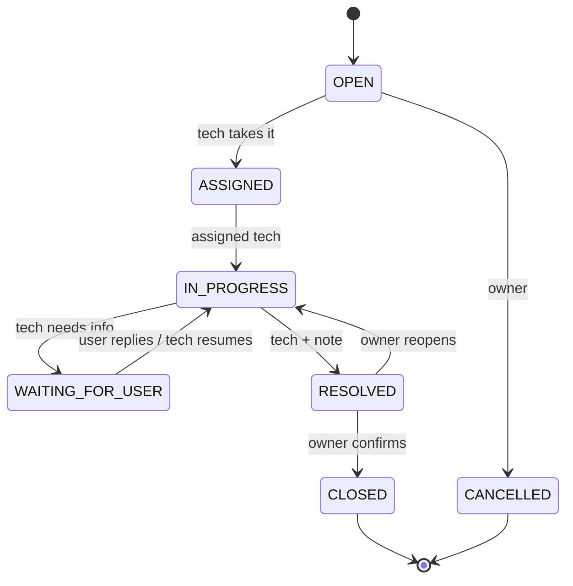
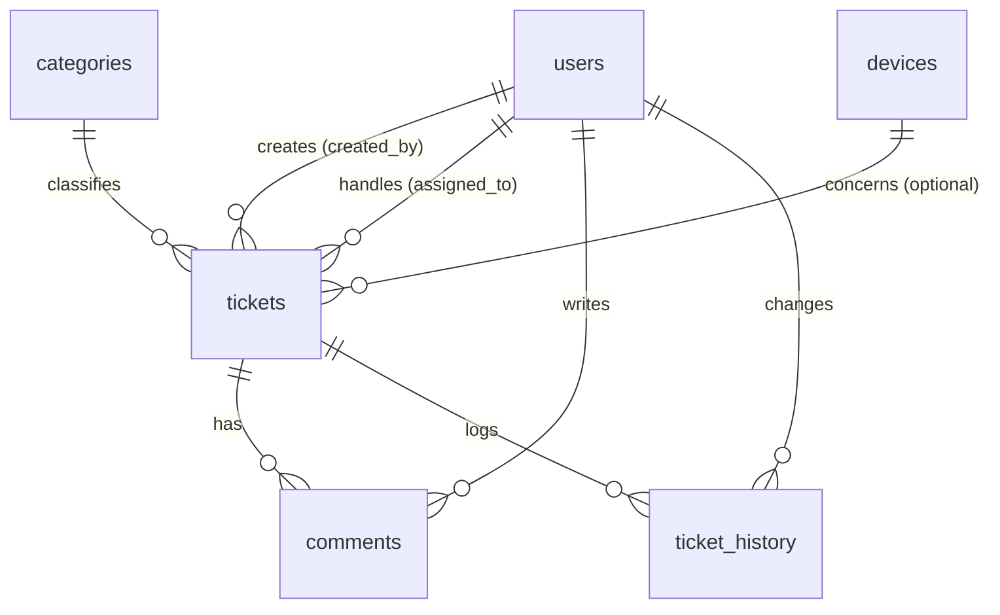

# FixIT: teaching guide, test checklist and honest limits

> **Honest limits first.** I could not compile or run this app (no Android SDK here). I checked statically with a script that every `R.string / R.color / R.dimen / R.drawable / R.layout / R.id / R.menu / R.array / @style` reference exists and that every `findViewById<Type>` matches the tag in the XML. That does NOT replace a real build. See section 9 for where to look first.

## 0. Setup

1. Unzip, then in Android Studio: **File > Open** the `FixIT` folder. If it asks for a Gradle version, use **8.7** (AGP 8.5.2, Kotlin 1.9.24, JDK 17). The Gradle wrapper *jar* is not included; Android Studio downloads Gradle from `gradle-wrapper.properties`.
2. Dependencies (`app/build.gradle.kts`). ZXing is the only extra:
```kotlin
implementation("com.journeyapps:zxing-android-embedded:4.3.0")
implementation("com.google.zxing:core:3.5.3")
```
I am fairly (not 100 %) sure of these versions; if Gradle cannot resolve one, pick the latest on Maven Central. `compileSdk 34`, `minSdk 24`.
3. Manifest: `CAMERA` permission, `uses-feature camera required=false`, 9 activities, a `FileProvider` (for sharing the sticker image) with `res/xml/file_paths.xml`. Theme `Theme.FixIT` extends `Theme.Material3.Light.NoActionBar` (no night theme exists).
4. To reset the demo data: uninstall the app (the DB is re-created and re-seeded on first launch).

**Demo accounts**

| Role | Email | Password |
|---|---|---|
| TECH | tech1@fixit.local | Tech1234 |
| TECH | tech2@fixit.local | Tech5678 |
| USER | sara@fixit.local | User1234 |
| USER | ali@fixit.local | User1234 |
| USER | mona@fixit.local | User1234 |

(The spec only asked for 2 technicians; I added 3 demo users so tickets have owners.)

## 1. Architecture

```
com.fixit.app
  model/   Models.kt            data classes + enums (Role, Status, Priority, DeviceType, Violation)
  logic/   TicketRules.kt       workflow + permissions + SLA side effects   (pure Kotlin)
           SlaPolicy.kt         deadlines, states, statistics               (pure Kotlin)
           PasswordHasher.kt    salt + SHA-256                              (pure Kotlin)
           QrPayload.kt         FIXIT:DEVICE:<code> validation              (pure Kotlin)
  data/    DBHelper.kt          SQLite: schema, seed, one function per query, transactions
           Session.kt           logged-in user (+ "Remember me")
  ui/      UiExtensions.kt      edge-to-edge, insets, setupScreen, showFieldError, requireLogin
           UiHelpers.kt         labels, chips, adapters, LiveTicker, dialogs
           QrSticker.kt         draws the printable sticker bitmap
           Login/Register/Main (+ Home/Tickets/Stats/Profile fragments)
           NewTicket/TicketDetail/Scan/Devices/DeviceForm/DeviceQr activities
```
The idea: **rules live in `logic/` and `DBHelper`, never in the Activities.** An Activity only asks, then shows the answer.

## 2. The story of one ticket

1. **Sara (USER)** scans the sticker `FIXIT:DEVICE:PC-B2-001`. `ScanActivity` validates the text, finds the device, opens `NewTicketActivity` with the device, room and category *Hardware* pre-filled. She writes a title and description, priority *High*.
   DB: `tickets` row (status `OPEN`, `due_at = now + 4 h`) and a `ticket_history` row (`null -> OPEN`), in one transaction.
2. **Karim (TECH)** opens the ticket, taps *Take this ticket*. `OPEN -> ASSIGNED`; `assigned_to = Karim`. History row written. A second technician now gets "already taken".
3. Karim taps *Start working*: `ASSIGNED -> IN_PROGRESS`.
4. He needs info: *Need info from user* + note. `IN_PROGRESS -> WAITING_FOR_USER`, `paused_at = now`: **the clock stops** (chip shows "Paused").
5. Sara writes a comment. `addComment` sees: owner + status WAITING, so it moves the ticket to `IN_PROGRESS` automatically. `due_at += (now - paused_at)`, `paused_at = NULL`. History: "User replied".
6. Karim taps *Mark as resolved*. A **resolution note is required**. `IN_PROGRESS -> RESOLVED`, `resolved_at = now`: the countdown stops. If `resolved_at <= due_at` it counts as "on time".
7. Sara either taps *Still broken* (`RESOLVED -> IN_PROGRESS`, `due_at` recomputed from now, `resolved_at = NULL`) or *Confirm it is fixed*: `RESOLVED -> CLOSED`, `closed_at = now`.
8. After CLOSED she can rate 1 to 5 stars, once (`rating` column).

## 3. Workflow and transition table



| From | To | Who | Extra condition |
|---|---|---|---|
| OPEN | ASSIGNED | any TECH | ticket not yet assigned |
| OPEN | CANCELLED | owner | |
| ASSIGNED | IN_PROGRESS | the assigned TECH | |
| IN_PROGRESS | WAITING_FOR_USER | the assigned TECH | |
| IN_PROGRESS | RESOLVED | the assigned TECH | non-empty resolution note |
| WAITING_FOR_USER | IN_PROGRESS | owner (reply) or assigned TECH | |
| RESOLVED | CLOSED | owner | |
| RESOLVED | IN_PROGRESS | owner (reopen) | deadline recomputed |
| CLOSED, CANCELLED | anything | nobody | final |

## 4. Business rules and where they are enforced

| Rule | Enforced in |
|---|---|
| Only listed transitions exist | `TicketRules.allowed` / `check()` rule 1 |
| Only TECH sets ASSIGNED / WAITING / RESOLVED (and IN_PROGRESS from ASSIGNED) | `TicketRules.check()` |
| One technician per ticket | `check()` (`assignedTo != null` -> `ALREADY_TAKEN`) + only OPEN can go to ASSIGNED |
| RESOLVED needs a note | `check()` (`NOTE_REQUIRED`) |
| Only the owner can CLOSE / reopen / cancel | `check()` (`NOT_OWNER`) |
| A user never sees another user's tickets | `DBHelper.getTicketsFor` (SQL `WHERE created_by`) and `getTicketForUser` (`canView`) |
| Every status change writes history **in the same transaction** | `DBHelper.changeStatus` (`beginTransaction` ... `setTransactionSuccessful`) |
| Rating only on CLOSED, owner only, once | `DBHelper.rateTicket` + `TicketRules.canRate` + SQL `rating IS NULL` + `CHECK(rating BETWEEN 1 AND 5)` |
| Reply on WAITING moves back to IN_PROGRESS | `DBHelper.addComment` (same transaction as the comment) |
| Registration creates USER only | `DBHelper.register` |
| Only USER creates tickets (my assumption) | `DBHelper.createTicket` |
| Device screens TECH only | each Activity's `onCreate` role check |

`DBHelper.changeStatus` is the single door: load ticket -> `TicketRules.check` -> `TicketRules.effects` -> UPDATE + INSERT history -> commit. The buttons shown on screen come from `TicketRules.availableActions`, but even a forged call is refused by `check`.

## 5. How the SLA timer works

- `SlaPolicy.durationMs`: CRITICAL 1 h, HIGH 4 h, MEDIUM 24 h, LOW 72 h (one `when`, change them there).
- `due_at = created_at + duration`, computed at creation.
- **Pause rule**: entering WAITING stores `paused_at`; leaving WAITING does `due_at += now - paused_at`, `paused_at = NULL` (`TicketRules.effects`).
- **Reopen rule**: RESOLVED -> IN_PROGRESS sets `due_at = now + duration(priority)`.
- Countdown stops at RESOLVED (`resolved_at`). Not shown for RESOLVED / CLOSED / CANCELLED.
- State (`SlaPolicy.evaluate`): PAUSED if waiting; OVERDUE if `due_at < now`; DUE_SOON if remaining <= 25 % of the priority's duration; else ON_TRACK. Text is always shown ("3h 20m left", "Due soon · 40m left", "Overdue by 40m", "Paused (waiting for user)").
- **Live refresh**: `LiveTicker` posts a `Runnable` every 30 s on the main `Handler`. Home, Tickets, Stats and Ticket details call `ticker.start()` in `onResume` and `ticker.stop()` in `onPause`, so nothing runs when the screen is hidden.
- Statistics (`SlaPolicy.stats`): % resolved within SLA = tickets with `resolved_at <= due_at` divided by tickets with a `resolved_at`; average of `resolved_at - created_at`; overdue count.

## 6. How the QR flow works

1. **Generate** (TECH, `DeviceQrActivity`): payload `FIXIT:DEVICE:<code>` (`QrPayload.build`) -> ZXing `BarcodeEncoder` -> `QrSticker` draws QR + code + room on a white bitmap. *Save image* uses the system file picker (`CreateDocument`, no storage permission needed); *Share* writes a PNG in `cacheDir/qr` and shares it through `FileProvider`.
2. **Scan** (`ScanActivity`): camera permission check; a short rationale panel with *Allow camera*; if refused with "don't ask again" the panel offers *Open app settings*. `DecoratedBarcodeView` gives the framing rectangle and instruction; *Flashlight* toggles the torch; *Enter code* is the manual fallback.
3. **Validate**: `QrPayload.parse` accepts only `FIXIT:DEVICE:` + 3 to 30 chars of `A-Z 0-9 -`. Otherwise "This is not a FixIT device QR code". Unknown code -> "No device with this code exists".
4. **Auto-fill**: USER -> `NewTicketActivity` with the device, room and suggested category (PC/Projector -> Hardware, Router -> Network, Printer -> Printer). TECH -> device screen with its ticket history.

## 7. Login, roles and password hashing

- Launcher = `LoginActivity`. Every other Activity calls `requireLogin()`; no session -> back to Login.
- "Remember me" stores only the user id in SharedPreferences.
- Password: random 16-byte salt (`SecureRandom`), stored hash = `SHA-256(salt + password)` in hex, both in `users`. Login recomputes and compares with `MessageDigest.isEqual`. The salt makes equal passwords look different and defeats pre-computed tables. (Real apps would use PBKDF2/bcrypt; SHA-256 is chosen because it is easy to explain.)

## 8. Database


`users` accounts and roles; `categories` the 6 fixed categories; `devices` equipment with unique code; `tickets` the core row incl. SLA columns; `comments` the conversation; `ticket_history` an audit trail (who, old/new status, note, when). Foreign keys are switched on in `onConfigure`; indexes on owner, technician, status, device, comment/history ticket. Times are epoch milliseconds. `onUpgrade` drops and rebuilds (fine for an exam project).

### File by file

| File | What it does |
|---|---|
| Models.kt | Data classes and enums |
| TicketRules.kt | Transition table, permissions, SLA side effects, which buttons to show |
| SlaPolicy.kt | Deadlines, state, formatting, statistics |
| PasswordHasher.kt / QrPayload.kt | Hash+salt / strict QR validation |
| DBHelper.kt | Schema, demo data (14 devices, 15 tickets), all queries, transactions |
| Session.kt | Current user, Remember me |
| UiExtensions.kt | Edge-to-edge, insets, `setupScreen`, `showFieldError`, `requireLogin` |
| UiHelpers.kt | Enum labels, chip colours, `applySla`, adapters, `LiveTicker`, dialogs |
| QrSticker.kt | Draws the sticker |
| LoginActivity / RegisterActivity | Forms with inline validation |
| MainActivity | Bottom navigation by role, hosts the fragments |
| HomeFragment | Counters, quick actions, 3 most urgent tickets |
| TicketsFragment | Search, status chips, priority filter, sort |
| StatsFragment | SLA statistics (TECH) |
| ProfileFragment | Name, role, Devices (TECH), logout with confirmation |
| NewTicketActivity | Create a ticket, QR pre-fill |
| TicketDetailActivity | Info, timeline, role-based actions, rating, comments, history |
| ScanActivity | Camera, permission handling, validation, manual entry |
| DevicesActivity / DeviceFormActivity / DeviceQrActivity | Device list+search / add-edit with duplicate warning / sticker + history |

Layouts: one per screen above (`activity_*`, `fragment_*`) plus `item_ticket`, `item_device`, `item_step`, `item_history`, `item_comment`, `item_action_primary/secondary`, `dialog_input`, `layout_top_bar`, `layout_empty_state`.

**Navigation map**
```
Login -> Register -> (auto login) -> Main
Login -> Main [Home | Tickets | (Scan) | (Stats, TECH) | Profile]
Main/Home --Scan--> ScanActivity --USER--> NewTicket --> TicketDetail
                              \--TECH--> DeviceQr --> TicketDetail / DeviceForm
Main/Tickets -> TicketDetail ;  Home/Profile (TECH) -> Devices -> DeviceQr / DeviceForm
NewTicket --Scan--> ScanActivity (returns the code)
```

## 9. Honest limits and where to look first

1. **Not compiled.** Open Android Studio's *Build > Rebuild Project* and read the first error.
2. Gradle versions (AGP 8.5.2 / Kotlin 1.9.24 / ZXing 4.3.0 + core 3.5.3): the most likely cause of a sync failure.
3. `ScanActivity`: the `BarcodeCallback` signature and `DecoratedBarcodeView` API depend on the ZXing version.
4. Material attributes in `styles.xml` (`cornerRadius`, `strokeColor`) and `Widget.Material3.*` parents.
5. `enableEdgeToEdge` / `SystemBarStyle` need `androidx.activity` 1.8+ (set to 1.9.1).
6. Camera behaviour is only real on a **device or an emulator with a virtual camera**; test the QR by showing a generated sticker on another screen.
7. SHA-256 is not a slow password hash. No unit tests are included, but `logic/` is pure Kotlin so you can add JUnit tests easily.
8. Choices I made: Closed/Cancelled chip colours; TECH cannot create tickets; "Scan" for a TECH opens the device screen; the sticker save uses the file picker; the launcher icon is a simple vector; only `en` strings.

## 10. Three-minute demo script

1. (0:00) Log in as **sara@fixit.local**. Home: show Overdue / Due soon counters and live chips.
2. (0:30) *Scan QR* > *Enter code* `PC-B2-001`: the ticket form opens with device, room, category *Hardware*. Write title + description, priority Critical, submit.
3. (1:00) Log out, log in as **tech1@fixit.local**. *Tickets*, sort *Most urgent first*, open the new ticket, *Take*, *Start*, *Need info from user* (chip becomes "Paused").
4. (1:45) Log in as Sara, comment on that ticket: it returns to *In progress* automatically (see History).
5. (2:15) As Karim: *Mark as resolved* (try empty note first: refused), then as Sara *Confirm it is fixed*, then rate 5 stars.
6. (2:45) As Karim: *Stats* tab, then *Profile > Devices > PC-B2-001 > Save image* to show the QR sticker.

## 11. Test checklist (emulator)

**Accounts**
- [ ] App opens on Login. Wrong password shows an inline error. Empty fields show inline errors.
- [ ] Register with a new email works; duplicate email is refused; password < 6 or mismatch refused.
- [ ] "Remember me" ticked: close and reopen the app, you stay logged in. Logout asks confirmation and clears it.

**Visibility and roles**
- [ ] sara sees only her own tickets (ali's and mona's are absent). tech1 sees all 15.
- [ ] USER nav: Home, My tickets, Scan, Profile. TECH nav: Home, Tickets, Scan, Stats, Profile. Devices reachable from Home and Profile (TECH only).

**Workflow (must succeed)**
- [ ] USER creates ticket (with and without a device). Title < 5 chars / description < 10 chars show inline errors.
- [ ] tech1 *Take*: status Assigned, technician shown. *Start*, *Need info*, comment by owner returns to In progress, *Resolve* with note, owner *Close*, owner rates once.
- [ ] Owner can cancel only while Open (confirmation shown). Owner *Still broken* on a Resolved ticket reopens it.
- [ ] Every change appears in History with who/old/new/note.

**Must be refused**
- [ ] tech2 cannot take a ticket tech1 already took (the button is not offered; the DB layer also refuses).
- [ ] *Resolve* with an empty note: inline error in the dialog, nothing changes.
- [ ] USER sees no technician buttons; TECH sees no Close/Reopen/Cancel on someone else's ticket.
- [ ] A Closed or Cancelled ticket offers no action and no comment box. Rating a second time is impossible (card shows "Rated n/5").
- [ ] Rating before Closed: the rating card is not shown.

**SLA**
- [ ] Seed data shows On track, Due soon, Overdue and Paused chips. Counters on Home match.
- [ ] Wait about 30 s: chips update with no reload. Leave the screen: no timer runs (put a log in `LiveTicker.run` to check).
- [ ] Waiting ticket: chip "Paused"; after the user replies the Deadline date moved later by the paused time.
- [ ] Reopen: Deadline recalculated from now. Resolved ticket shows no countdown.
- [ ] Sort "Most urgent first": overdue/soonest first, paused next, finished last.
- [ ] Stats: % within SLA, average time, overdue count are filled (seed: 3 of 4 resolved on time = 75 %).

**QR**
- [ ] Devices (TECH): search by code/room, add a device, duplicate code shows a warning live and on save; edit shows the "printed stickers" warning.
- [ ] Device QR: sticker shows QR + code + room; Save image and Share work; ticket history of the device is listed.
- [ ] Scan a valid sticker (USER): New ticket pre-filled. Scan another QR/text: "This is not a FixIT device QR code". Valid format but unknown code: "No device with this code exists".
- [ ] Camera permission: deny once (rationale remains), deny with "don't ask again" (Open settings button appears), allow in Settings and return (camera starts). Manual entry works with and without permission.

**Design**
- [ ] Edge-to-edge: nothing hidden behind status/navigation bars or the keyboard. Every list has an empty state (filter to a status with no tickets). Icon buttons have content descriptions.
